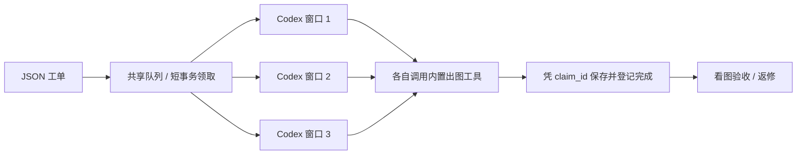

# Codex Image Queue

**一张图一份 JSON，多个窗口各领各的。你负责验收，别把自己干成下载员。**

Dr. Wang 的批量出图工作流公开版：可安装的 **Codex Skill**，加一套可独立运行的 **Python 队列工具**。适合角色立绘、道具图标、批量概念图，以及带原图的返修。



## 能做什么

- JSON 写明任务编号 `job_id`、图片 `id`、`prompt` 和最终保存路径 `output_path`。
- 多个进程共享本地队列，事务控制领取；不同窗口拿不同任务。
- 拒绝重复任务编号和冲突输出路径；已完成记录继续保留。
- 每次领取有独立 `claim_id` 和临时输出目录。作废凭证不能再提交。
- 失败留原因；确认旧工人停止后才能恢复；总尝试次数有上限。
- 只使用 Python 标准库，无遥测、无网络请求、不保存账号凭证。

**出图能力由宿主 Codex 会话提供。** 本仓库不包含模型，不会给不支持出图的账号解锁功能。订阅内出图仍遵循产品用量规则；某次百分比基本不变，不等于永久免费或无限额度。自行连接其他 API 时遵循对应服务的费用和限制。

## 安装 Skill

需要 Python **3.11+**、支持内置出图的 Codex 会话和本地磁盘。下载仓库后，在仓库根目录运行：

```sh
python scripts/install_skill.py
```

默认安装到 `$CODEX_HOME/skills/codex-image-queue`，未设置时为 `~/.codex/skills/codex-image-queue`。遇到已有目录会停止，不覆盖。重新加载技能或新开会话，然后说：

> 使用 $codex-image-queue，做三张游戏道具图标：药剂、钥匙、遗物。统一手绘风格，分开保存到 art/icons。先建立工单，生成后让我验收。

多窗口可以这样交代：

> 使用 $codex-image-queue 处理共享队列，队列绝对路径是 QUEUE_HOME，你是 worker-1。每次领一张，使用会话内置出图工具，完成后继续。工具不可用就报告，不要自行换成付费 API。

第二个窗口改成 `worker-2`。所有窗口使用**同一个队列绝对路径**。默认本地并发上限是 3，按账号实际能力调整；这不是服务方并发额度承诺。

## 命令行用法

下列相对路径示例要求所有窗口都从同一个仓库根目录执行；实际多窗口推荐 `--home` 使用绝对路径。

```sh
python image_queue.py --home ./.queue init --max-active 3 --max-attempts 3
python image_queue.py --home ./.queue enqueue --job-file examples/portrait.json --base-dir .
python image_queue.py --home ./.queue claim --worker-id worker-1
```

领取结果包含 `claim_id`、`next_item` 和本次尝试的 `generation_output_path`。Codex 用自己的原生工具生成，拿到本地文件后提交：

```sh
python image_queue.py --home ./.queue complete --claim-id CLAIM_ID --source GENERATED_LOCAL_FILE
python image_queue.py --home ./.queue status
```

**不要直接写最终输出路径。** `complete` 会保存图片并登记；已经存在的不同文件会被保留。工具只返回图片展示时，要用宿主支持的保存方式取得本地文件；不能编造路径。CLI 本身不会控制 Codex UI，也不会启动模型。

## 报错、掉线、返修

```sh
python image_queue.py --home ./.queue fail --claim-id CLAIM_ID --error "具体失败原因"
python image_queue.py --home ./.queue retry --job-id JOB_ID

# 恢复预览，不修改状态
python image_queue.py --home ./.queue recover --claim-id CLAIM_ID

# 确认原窗口/请求已经停止后，才执行恢复
python image_queue.py --home ./.queue recover --claim-id CLAIM_ID --confirm-worker-stopped
```

有本次尝试的图片就核对并提交；没有图片就重新排队；达到总尝试次数上限就停止。旧凭证作废后不能再提交。

**超时不等于旧请求已经停止。** 本版只标出疑似过期任务，不会单凭时间自动重发。异常恢复不承诺远端生成严格只发生一次。

图片不好看属于质量验收：另写一份新 JSON、新编号和新输出路径，调整提示词，或在 `reference_images` 中附原图。技术失败的 `retry` 则沿用任务编号、换新的领取凭证。

## 验证和适用范围

```sh
python -m unittest discover -s tests -v
```

测试在独立临时目录使用合成小图片，覆盖跨进程并发、去重、输出冲突、过期凭证和失败恢复，不调用任何出图服务。

适用于同一台电脑的多个窗口。队列目录放本地磁盘，不放网盘同步目录/NFS。最终文件发布需要支持硬链接的文件系统（如 NTFS、ext4、APFS）；不支持时明确报错并保留候选文件。程序做图片文件头检查，完整解码和审美质量需要验收。

公开版在原游戏开发队列经验上整理：保留 JSON 工单，状态登记使用 SQLite 事务，使编号去重和领取失效更可靠；不会修改原生产队列。

[工单与工人协议](skills/codex-image-queue/references/protocol.md) · [Skill](skills/codex-image-queue/SKILL.md) · [发布步骤](RELEASE.md) · [MIT 许可证](LICENSE)

参考：[OpenAI Skills](https://developers.openai.com/plugins/build/skills)、[Codex 内置出图与用量](https://learn.chatgpt.com/docs/image-generation)。非 OpenAI 官方项目。
